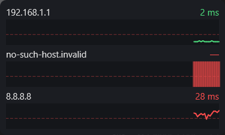

# PingWidget

Маленький виджет для Windows: постоянно пингует список адресов и рисует по каждому heartbeat-график.
Пока пинг ниже порога, линия зелёная. Выше порога появляются красные пики, а потерянный пакет показан красной вертикальной полосой.



## Как пользоваться

- Программа живёт в трее. Меню иконки:
  - **Показывать на рабочем столе**: карточка висит поверх окон (по умолчанию в правом нижнем углу). Если галочку снять, останется только иконка в трее. Двойной клик по иконке делает то же самое.
  - **Настройки…**: список адресов и порог для каждого в мс.
  - **Запускать с Windows**
  - **Выход**
- Карточку можно перетащить мышью, в том числе на другой монитор. При следующем запуске она откроется на том же месте. Если тот монитор отключён, карточка встанет в угол основного.
- Иконка в трее краснеет, когда у какого-то адреса 3 из последних 5 пингов выше порога или потеряны.
- Пинг идёт раз в секунду (таймаут 1 с), на графике последние 2 минуты.

Адреса по умолчанию: `192.168.1.1` (10 мс), `192.168.0.1` (20 мс), `8.8.8.8` (100 мс).

Настройки хранятся в `%APPDATA%\PingWidget\settings.json`.

## Требования

Windows 10/11 и [.NET 8 Desktop Runtime](https://dotnet.microsoft.com/download/dotnet/8.0).

## Сборка

```
dotnet test
dotnet publish src/PingWidget -c Release -o publish
```

Результат — один файл `publish/PingWidget.exe`, устанавливать ничего не нужно.

## Структура

- `src/PingWidget/Core`: логика без UI (настройки, пинг, история, правило «3 из 5», геометрия графика, расположение окна, автозапуск).
- `src/PingWidget/Widget`: карточка и график.
- `src/PingWidget/Tray`: иконка в трее.
- `src/PingWidget/Settings`: окно настроек.
- `tests/PingWidget.Tests`: xUnit-тесты.
